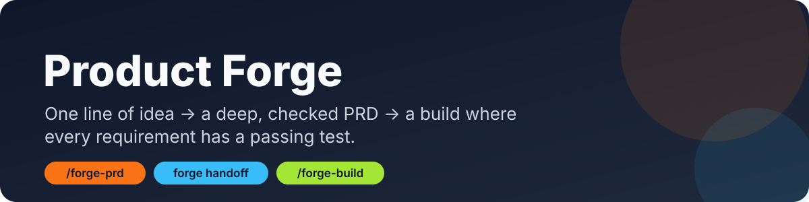
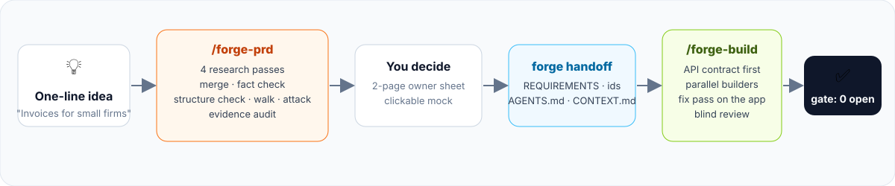
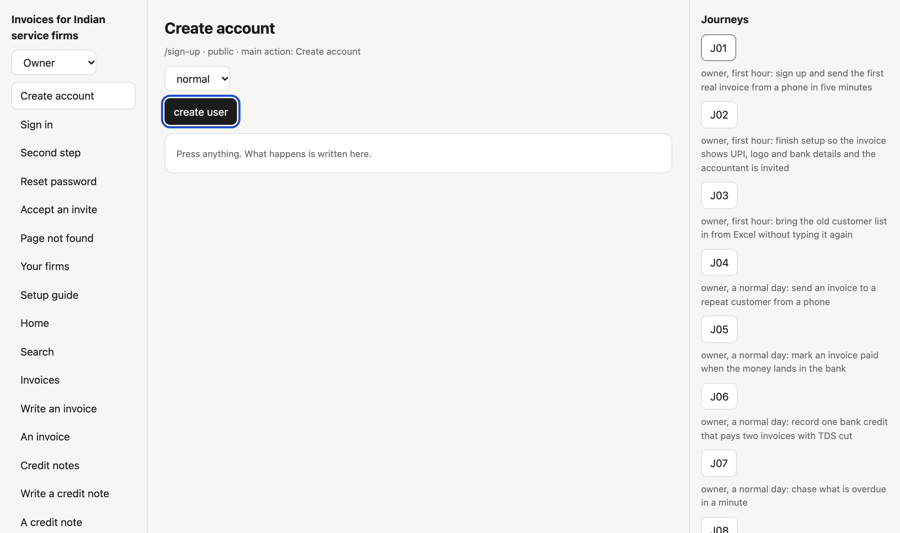

<p align="center"></p>

<p align="center">
  
  
  
  
</p>

<p align="center"><b>Stop shipping half-finished products.</b><br>
AI agents build exactly what the PRD says, and most PRDs forget the boring parts: edit after create, every filter, export options, undo, roles, empty screens, tax edges. Product Forge writes the PRD a mature product would have, then makes the build prove every line.</p>

---

## ⚡ Quick start

```bash
git clone https://github.com/rocker1166/product-forge ~/product-forge
```

```bash
cd ~/product-forge && ./install.sh
```

Then, in Claude Code, in any project:

```text
/forge-prd  Invoices and payments for small Indian service firms
```

That's it. You get a PRD, a two-page sheet of decisions for you, and a clickable mock.

## 🎚️ Three modes: pay for the depth you need

| Mode | For | Agents | Tokens (measured) |
|---|---|---|---|
| **lite** | a feature, a quick idea check | 2 to 3 | ~0.4M |
| **standard** (default) | a module or a small product | 8 to 12 | ~1.5M |
| **full** | a product you will really build | 20 to 25 | ~3.5M |

**The lead agent chooses the model for each job.** Defaults:

| Job | Default model |
|---|---|
| Coordinate, judge, write the owner sheet | your session model |
| Research, fill the spec, build, fix, review | Sonnet |
| Audit sources, count, read one fact from a long file | Haiku |

These are defaults, not rules: when the lead judges a task needs more (core money, tax or security logic, a hard architecture call, a part that failed once), it uses **Opus** for that task, and goes cheaper when a job is plain. Every choice and its reason goes in `COST.md`, with the tokens each agent used and a budget it stops at when a step runs 50% over.

## 🧭 How it works

<p align="center"></p>

| Step | Command | You get |
|---|---|---|
| 1. Plan | `/forge-prd` | Wide list from real products → waves → fact-checked rules → objects, states, roles, screens, journeys → walked, attacked, audited |
| 2. Decide | open `OWNER-SHEET.md` and `MOCK.html` | 8 to 12 questions with a recommended answer each |
| 3. Hand over | `forge handoff spec ./my-app` | `REQUIREMENTS.md`, `ids.txt`, `AGENTS.md`, one `CONTEXT.md` per module |
| 4. Build | `/forge-build` | API contract first, parallel agents, a fix pass on the running app, a blind review |
| 5. Prove | `bun gate.ts` | Done = every requirement has a passing test that names it, like `[W042]` |

## 👀 What you get

**A clickable mock, straight from the spec.** Pick a role, run a journey, see every screen and state before any code exists.

<p align="center"></p>

**A checker that refuses gaps.** Blank answers, states with no way out, actions nobody may do, filters with no index, requirements that land nowhere:

```text
$ forge check spec
JOURNEY (1)
  J1#2: STUCK: customer.create is not on invoice_form

838 of 839 filled, 1 missing. Filled does not mean right.
```

**A real example:** [`examples/invoices-india`](examples/invoices-india), a full PRD for invoices and payments for small Indian service firms. 452 wave-1 requirements, 27 objects, 68 money and tax rules with worked numbers, 54 screens, a mock and an owner sheet.

## 🛡️ Common sense and security, built in

`forge baseline spec` adds **44 requirements every product needs** to your PRD, and the check stays red until each one is landed or refused in words:
- **24 common sense:** reload keeps filters, Back works, unsaved-changes warning, no double submit, not-found page, keyboard and labels, local money format, print pages…
- **20 security (OWASP ASVS L1 in plain words):** tenant isolation, server-side role checks, rate limits, safe uploads, expiring share links, no secrets in logs, delayed bank-detail changes, consented support access…

In the blind build test, both apps missed about 12 of 40 common-sense checks because no PRD said them. Now every PRD says them.

**`walk.ts` measures the running app:** every page at desktop and phone width, reporting console and server errors, slow pages, sideways scroll, unlabeled inputs, nameless buttons, repeated titles and a wrong not-found status. On a test app it found exactly what the blind judges had flagged.

```bash
bun ~/product-forge/bin/walk.ts http://localhost:3000 --email owner@test.dev --password secret
```

## 🧪 Tested, failures kept in

We did not trust it, so we tested it against plain methods, with blind judges.

| Test | What happened | So |
|---|---|---|
| Find a real product's features from one line | Plain four-pass list **74%**, structured map 54% | Lists find first |
| Build the same 90 requirements twice | List + one test per line **88 right, 0 skipped**; map-driven build 83, 36% dearer | The build rule is one test per line |
| Fact check of tax and law lines | **14 of 68** were wrong or out of date | Never skip the fact check |
| Evidence audit | about half the cited sources held | A hard cap on "judgement" made agents fake sources, so it's a warning now |

Full write-up: [docs/RESULTS.md](docs/RESULTS.md) · raw data: [`eval/`](eval)

## 🛠️ Commands

`forge` = `bun ~/product-forge/bin/forge.ts`

```bash
forge init spec                 # start a spec folder
forge check spec                # what is missing or unlinked (exit 1 if anything)
forge print spec                # PRD.md, prd/*.md, OWNER-SHEET.md
forge mock spec                 # MOCK.html, clickable
forge harvest spec stripe openapi https://raw.githubusercontent.com/stripe/openapi/master/openapi/spec3.json invoice
forge baseline spec             # add 24 common-sense + 20 security requirements
forge demote spec               # after an audit: weak sources become "judgement"
forge handoff spec ./my-app     # requirements, ids, AGENTS.md, module context
bun ~/product-forge/bin/gate.ts # every requirement has a passing test?
bun ~/product-forge/bin/walk.ts http://localhost:3000   # measured walk of the running app
```

`harvest` reads public **GraphQL, OpenAPI, Frappe DocType, Prisma and Rails** schemas, so you copy a mature product's real depth, deprecated fields included (that's the list of what they regret).

## 🎯 Use cases

| You have | Run |
|---|---|
| 💡 A new product idea | `/forge-prd` (size L) |
| 🧩 A new module for an existing app | `/forge-prd` (size M) |
| 🔍 A PRD you don't trust | `/forge-prd` passes A and D against it, then `forge check` |
| 🏗️ A PRD and a team of agents | `forge handoff`, then `/forge-build` |
| ✅ A build that claims "done" | `bun gate.ts` |

More: [docs/USE-CASES.md](docs/USE-CASES.md)

## 📦 What's inside

```text
skills/     forge · forge-prd · forge-build (+ ready briefs for each agent)
bin/        forge.ts · mock.ts · gate.ts · walk.ts · 92 tests
library/    44 baseline requirements · 13 object kinds · 37 abilities · 36 product areas · 21 flow rules · 30 production checks · 12 day-one decisions
examples/   invoices (small) · invoices-india (full PRD)
research/   what mature products and open-source logs taught us
eval/       both tests, judges' verdicts, scoring scripts
```

## ⚠️ Honest limits

- Two tests, one model family, small samples.
- It finds what is **missing**, not what is **wrong**: the checker says *filled*, never *right*.
- Common sense that isn't written in the list still gets missed in builds.
- Tax and law facts need a professional before you ship.

## 🗺️ Roadmap

A real end-to-end product run with published numbers · walk.ts that also fills forms safely · more schema formats. See [ROADMAP.md](ROADMAP.md).

## 📥 Install details

[docs/INSTALL.md](docs/INSTALL.md) · Needs [Bun](https://bun.sh) 1.3+ and [Claude Code](https://claude.com/claude-code).

<p align="center"><sub>MIT licence · PRs and issues welcome</sub></p>
